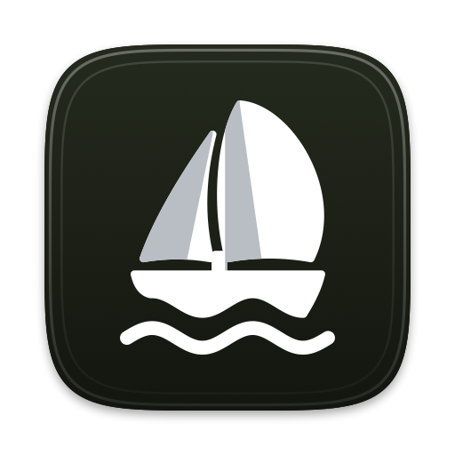
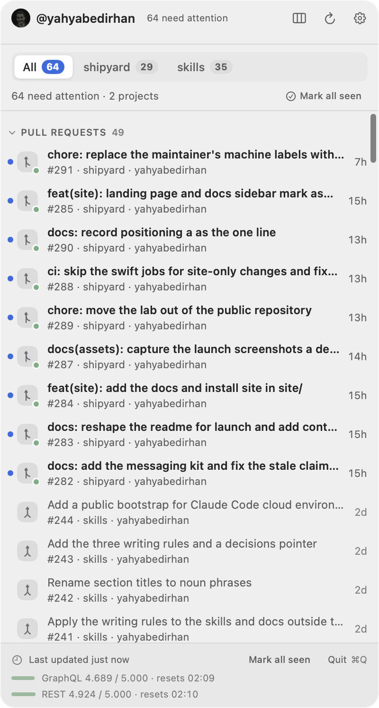
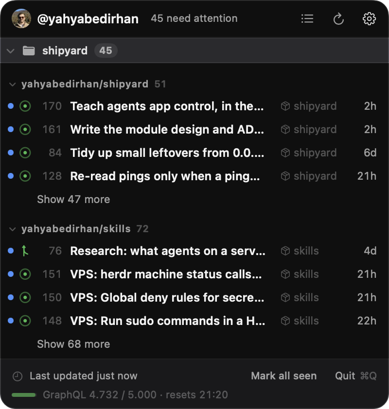
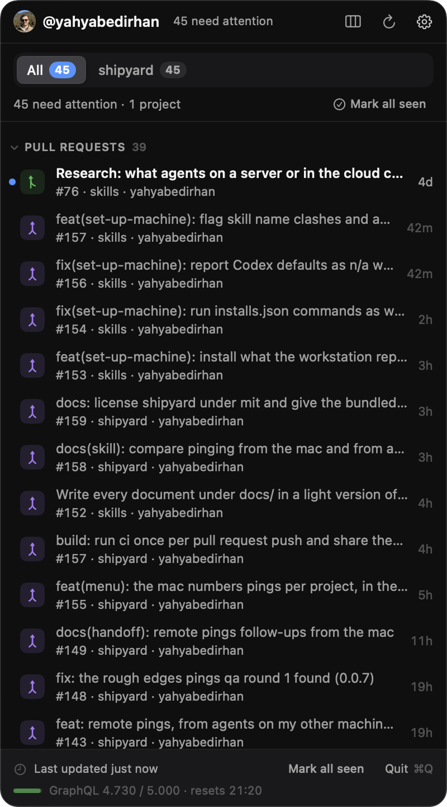
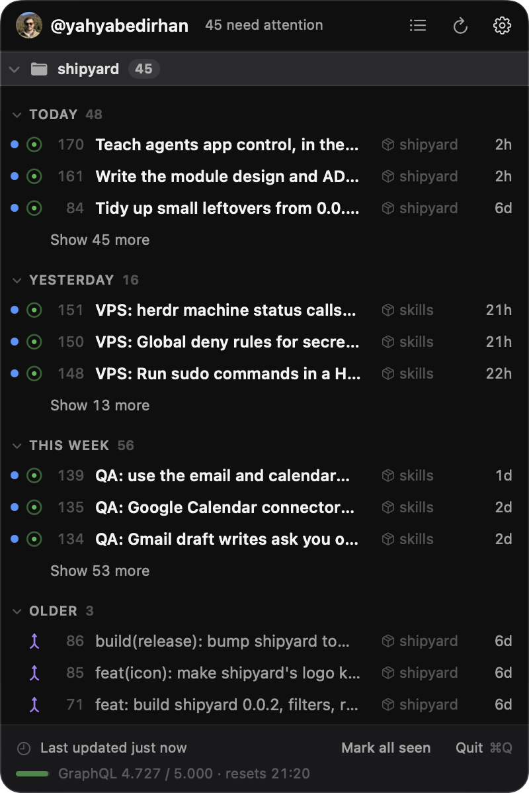
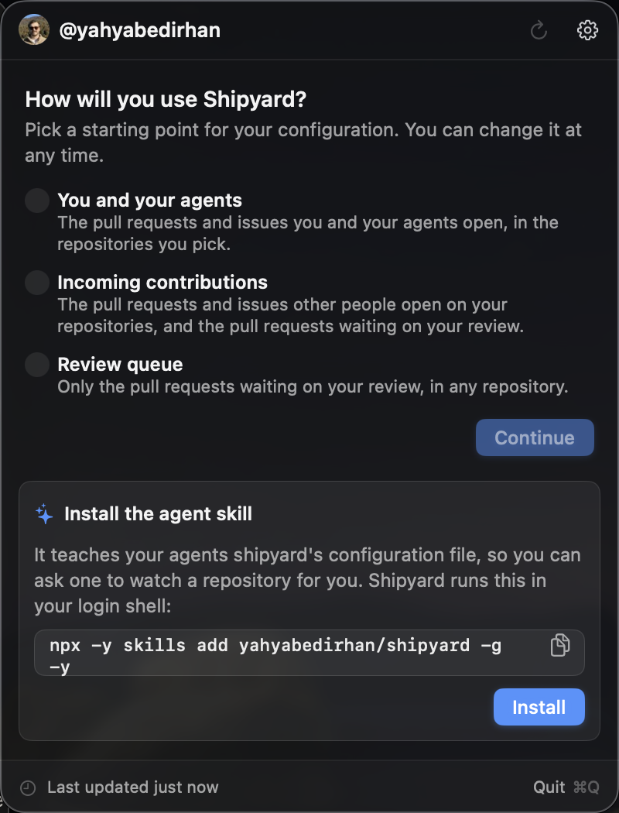

<p align="center"></p>

<h1 align="center">shipyard</h1>

<p align="center">A macOS menu bar app for the pull requests your agents open.</p>

<p align="center">
  <a href="https://shipyard.yahyapak.dev">Site</a> ·
  <a href="https://shipyard.yahyapak.dev/docs">Docs</a> ·
  <a href="https://github.com/yahyabedirhan/shipyard/releases/latest">Download</a> ·
  <a href="CHANGELOG.md">Changelog</a>
</p>
<!-- PLACEHOLDER: the Site and Docs links go live with shipyard.yahyapak.dev at launch. -->

**Status:** under construction; this README describes 0.7.1.

<!-- SHOT:readme-hero-light SHOT:readme-hero-dark -->
<p align="center">
  <picture>
    <source media="(prefers-color-scheme: dark)" srcset="assets/screenshots/themed-look/tabs-shipyard-dark.png">
    
  </picture>
</p>

```sh
git clone https://github.com/yahyabedirhan/shipyard.git && cd shipyard && make install
```

Then teach your coding agent to use it:

```sh
npx skills add yahyabedirhan/shipyard -g -y
```

and ask in your own words: "Watch this repo in shipyard".

## What it does

Coding agents open pull requests and issues and start workflow runs, often several at once across several repositories.
shipyard lists them in the menu bar, with what other people open, and shows one number: how many items need attention, because they are new, changed since you last opened them, waiting on your review, or failing their checks.
It notifies you when something happens, and your agents can ping you when they need you.
What it shows lives in one TOML file that you, or your agents, edit.

## Install

You need macOS 14 or later and a GitHub account.

**From source.** Building also needs the Command Line Tools with Swift 6 (`xcode-select --install`).

```sh
git clone https://github.com/yahyabedirhan/shipyard.git
cd shipyard
make install    # builds, signs and copies Shipyard.app to /Applications, then opens it
```

**From the download.** Get `Shipyard-<version>-macos.zip` from the [latest release](https://github.com/yahyabedirhan/shipyard/releases/latest).
It is not notarized yet, so clear the quarantine flag before the first launch:

<!-- PLACEHOLDER: the notarized download replaces the xattr step, and a Homebrew cask line joins this section, at the last launch step. -->

```sh
unzip Shipyard-<version>-macos.zip
mv Shipyard.app /Applications/
xattr -dr com.apple.quarantine /Applications/Shipyard.app
open /Applications/Shipyard.app
```

**Updating.** Run `git pull && make install` again, or replace the app with a newer zip.

**Uninstalling.** If you signed in with GitHub, choose **Sign out** in the gear menu first, and remove the agent skill with `npx skills remove shipyard -g` if you installed it.
Then quit shipyard and delete the app and its files:

```sh
rm -rf /Applications/Shipyard.app ~/.config/shipyard ~/Library/Application\ Support/Shipyard ~/.local/bin/shipyard
```

A source build also leaves its module cache and its signing keychain:

```sh
rm -rf ~/Library/Caches/shipyard
security delete-keychain ~/Library/Keychains/shipyard-signing.keychain-db
```

## First run

shipyard lives in the menu bar, with no Dock icon.

1. Connect GitHub: **Sign in with GitHub**, or use the [GitHub CLI](https://cli.github.com) if `gh` is signed in.
2. Choose a preset, a ready-made configuration for one use:
   - `my-agents`: the pull requests and issues you and your agents open, one project per repository.
   - `incoming-contributions`: what other people open on your repositories, bots left out, and the pull requests waiting on your review anywhere.
   - `review-queue`: only the pull requests waiting on your review, in any repository.
3. Choose what to watch: `my-agents` asks for the repositories, `incoming-contributions` offers all your repositories or the ones you pick, and `review-queue` asks for nothing.

Then:

- Click an item to open it on GitHub and mark it seen. **⌥-click** marks it seen without opening it.
- **↑**, **↓** and **Return** move through the items and open one. **⌘R** refreshes.
- The layout button in the panel's header switches between the `list` and `tabs` layouts.
- shipyard starts at login. Set `launch-at-login = false` to stop that.

## Configure

Everything lives in `~/.config/shipyard/config.toml`.
**Open configuration file** in the gear menu opens it.
Every key is optional, and each save applies at once.
A broken edit keeps the last good configuration and shows the error in the panel, and `shipyard config check` prints each problem with its line.

The file sets the projects (each a section of the menu with its repositories), the layout, what is shown (pull requests, issues, workflow runs, and whose), how items are grouped and sorted, and which events notify you.
[`skills/shipyard/SKILL.md`](skills/shipyard/SKILL.md) lists every key, its default and its allowed values, with worked examples.
[`skills/shipyard/presets.md`](skills/shipyard/presets.md) has the three presets in full.

The panel's look is a **theme**, picked by name with the top-level `theme` key.
Shipyard is the default, and five more come with the app: Native, Graphite, Paper, Midnight and Harbor.
A theme of your own is a **theme file**, one TOML file in `~/.config/shipyard/themes/`, that names its colours by what they mean, such as `surface.panel` or `text.secondary`, and can extend a built-in theme to change only a few of them:

```toml
theme = "Midnight"
```

[`docs/themes/example-custom.toml`](docs/themes/example-custom.toml) is a commented theme file to start from, and [`skills/shipyard/references/themes.md`](skills/shipyard/references/themes.md) lists every token and setting.
A theme file with a problem keeps the theme it last read, and the panel shows the file, the line and the problem; `shipyard config check` checks each theme file too.

The gear menu also lists the parts shipyard uses, **Set up GitHub**, **Set up Notion**, **Set up /shipyard skill** and **Set up shipyard command**, with a check mark beside each one that is set up.
Each opens a view of its status in the panel.

## Use it with your agents

### The agent skill

The skill teaches coding agents that read skills, such as Claude Code and Codex, to edit shipyard's configuration.
Install it during onboarding, from **Set up /shipyard skill** in the gear menu, or from a terminal:

```sh
npx skills add yahyabedirhan/shipyard -g -y
```

Then ask in your own words: "Watch this repo in shipyard", "Hide dependabot's pull requests", "Tell me when CI fails on this project", "Switch shipyard to tabs".
The agent edits the file, checks it against the schema, and reads shipyard's verdict on the save.

### Pings

Agents can ping you: a short message listed under the project they work in, with a notification, that takes you where they mean when you click it.
It opens a link, brings an app forward, or focuses the agent's Herdr tab.
They send it with the `shipyard` command that comes inside the app.
Link it onto your PATH from onboarding or from **Set up shipyard command** in the gear menu, which puts it at `~/.local/bin/shipyard`.

```sh
shipyard ping send "PR #57 is ready for review" --from claude --open https://github.com/my-org/shop/pull/57
shipyard ping send "Waiting for your input" --herdr --id shop-question   # brings you back to this Herdr pane
shipyard ping withdraw shop-question                                     # takes it back once you've answered
```

A ping is filed under the projects that watch the repository of the agent's working folder.
It needs attention until you click it, and leaves a day after you have seen it (`seen-window`), or when you dismiss it with its ✕.
Pings never reach GitHub.
With the skill installed, ask "ping me when the PR is ready" and the agent knows the rest; `shipyard ping --help` lists every flag.
If your `config.toml` lists its own notification rules, add `{ event = "ping.sent" }` to hear about pings.

For a status message that needs nothing from you, such as "tests running", agents use `shipyard notice send`: a notification when a rule selects `agent.notice`, never kept in the panel.

### Pings from your other machines

Agents on your other machines can ping you too, when your Mac's Herdr knows those machines as saved machines.
Install the [herdr-shipyard](https://github.com/yahyabedirhan/herdr-shipyard) plugin on each one, which puts the same `shipyard` command there:

```sh
herdr plugin install yahyabedirhan/herdr-shipyard
```

Then name them in `config.toml` by their Herdr labels:

```toml
[remote]
machines = ["alpha-vps"]
```

shipyard asks each machine for its pings through Herdr about every 30 seconds, and files them under the projects that watch their repositories, or under the machine's name.
Clicking one sent from a Herdr pane takes you to that agent.
On those machines the plugin also pings you by itself when Herdr marks an agent blocked, and takes the ping back when the agent goes on.
A machine that does not answer shows a quiet line and keeps its last pings.

### Notes

Your own notes, kept in Notion, list under each project too: one database per project, titled with the project's title, under a "Projects" page inside a "Shipyard Notes" page.
Dictate a note to any agent and it writes it there.
The menu lists each project's open notes, newest first, with their numbers (`SHOP-7`) and labels, and clicking one opens it in Notion.
The pencil icon on a project's header starts a note there.

Notes are opt-in, and shipyard keeps no Notion token of its own: it reads and writes through [`ntn`](https://developers.notion.com/cli/get-started/overview), Notion's CLI, with ntn's own login.

1. Install ntn: `curl -fsSL https://ntn.dev | bash`.
2. Run `ntn login` in Terminal and choose your notes workspace, then check with `ntn doctor` that it is ntn's default workspace.
3. Open **Set up Notion** in the gear menu and choose **Connect with ntn**.

Once connected, the notes are read every minute and whenever you open the menu.
While ntn is missing or logged out, or its workspace has no Shipyard Notes page, a banner says what to do, and `shipyard notes check` reports what is wrong.
**Disconnect** in the same view stops it, and `notes = { show = false }` in a project's block keeps that project's notes out.

## Examples

Each configuration below produced the screenshot under it, trimmed to the lines that matter.
The first three watch two repositories as one project, with issues turned on.

The list layout, grouped by repository under subheaders, four rows a group:

```toml
version = 1
[menu]
layout = "list"
[defaults]
group-by = "repository"
subsections = true
show-first = 4
[defaults.issues]
show = true
[[projects]]
slug = "shipyard"
repositories = ["yahyabedirhan/shipyard", "yahyabedirhan/skills"]
```



The same file in the tabs layout.
The All tab always groups by kind; each project's tab follows its configuration:

```toml
version = 1
[menu]
layout = "tabs"
[defaults]
group-by = "repository"
subsections = true
show-first = 4
[defaults.issues]
show = true
[[projects]]
slug = "shipyard"
repositories = ["yahyabedirhan/shipyard", "yahyabedirhan/skills"]
```



Grouped by date, three rows a group:

```toml
version = 1
[menu]
layout = "list"
[defaults]
group-by = "date"
subsections = true
show-first = 3
[defaults.issues]
show = true
[[projects]]
slug = "shipyard"
repositories = ["yahyabedirhan/shipyard", "yahyabedirhan/skills"]
```



A file with no projects, or no file at all: the panel asks how you will use shipyard, offers the three presets, and offers the agent skill:

```toml
version = 1
```



## Limits

- shipyard runs on macOS 14 or later. The `shipyard` command also runs on Linux, without the app.
- It reads github.com only, not GitHub Enterprise Server.
- The download is not notarized yet, and there is no Homebrew cask or automatic update yet.
- Most settings live in `config.toml`, edited by you or your agents. The app itself writes the file only for the preset and repositories chosen during onboarding, and for the layout button in the panel's header.
- With Herdr 0.9.3, clicking another machine's ping focuses its pane on that machine, but your Mac's Herdr window moves there only when it already shows that machine. Otherwise nothing visible happens and the ping is marked seen; switch Herdr to that machine yourself. Herdr has no command yet that switches an open window to a saved machine.

## Development

`make test` runs the tests, and `make release` builds the release zip.
With the Command Line Tools alone, the first build compiles the SDK's Swift modules (about 40 s); the `Makefile` keeps them in `~/Library/Caches/shipyard/ModuleCache`, so every other checkout and worktree reuses them.
Installing Xcode avoids the cost, since it ships them prebuilt.
Publishing a GitHub release runs the [`linux cli`](.github/workflows/linux-cli.yml) workflow, which attaches static Linux builds of the `shipyard` command (`shipyard-linux-x86_64`, `shipyard-linux-aarch64` and their `.sha256` files) to it.

[`CONTRIBUTING.md`](CONTRIBUTING.md) says how to report a problem and open a pull request, and [`SECURITY.md`](SECURITY.md) how to report a vulnerability.
Releases follow the Releases section of [`AGENTS.md`](AGENTS.md), and each one gets an entry in [`CHANGELOG.md`](CHANGELOG.md).
The design is in [`docs/low-level-design.md`](docs/low-level-design.md), the glossary in [`GLOSSARY.md`](GLOSSARY.md), and the words every public surface uses in [`docs/messaging.md`](docs/messaging.md).

### Forks: your own OAuth App

Sign in with GitHub uses the OAuth App client ID compiled into the build.
A fork should use its own: create an OAuth App on GitHub (**Settings > Developer settings > OAuth Apps**), tick **Enable Device Flow**, and put its client ID in `OAuthApp.clientID` in `Sources/ShipyardCore/GitHub/Auth/DeviceFlow.swift`.
Without one, the build connects through `gh` only.
See [`docs/references/github-device-flow.md`](docs/references/github-device-flow.md) for GitHub's limits.

## License

The code is licensed under the [Apache License 2.0](LICENSE).
See [LICENSE](LICENSE) and [NOTICE](NOTICE).
If you use or adapt it, please credit Yahya Bedirhan Pak with a link to [yahyapak.dev](https://yahyapak.dev).

The project name, the logo and app icon in `assets/images/` and the screenshots in `assets/screenshots/` are not covered by this license and are all rights reserved.
The bundled agent and service logos are their owners'; see [`THIRD-PARTY-NOTICES.md`](THIRD-PARTY-NOTICES.md).
