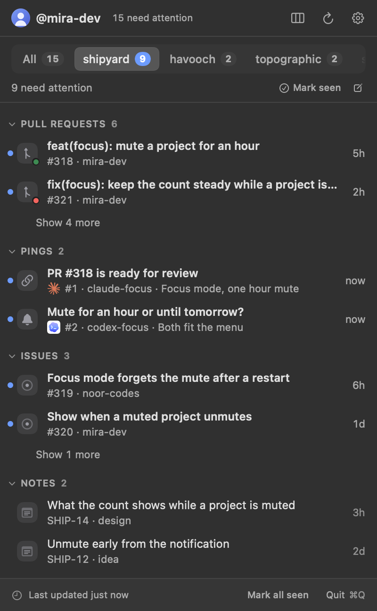
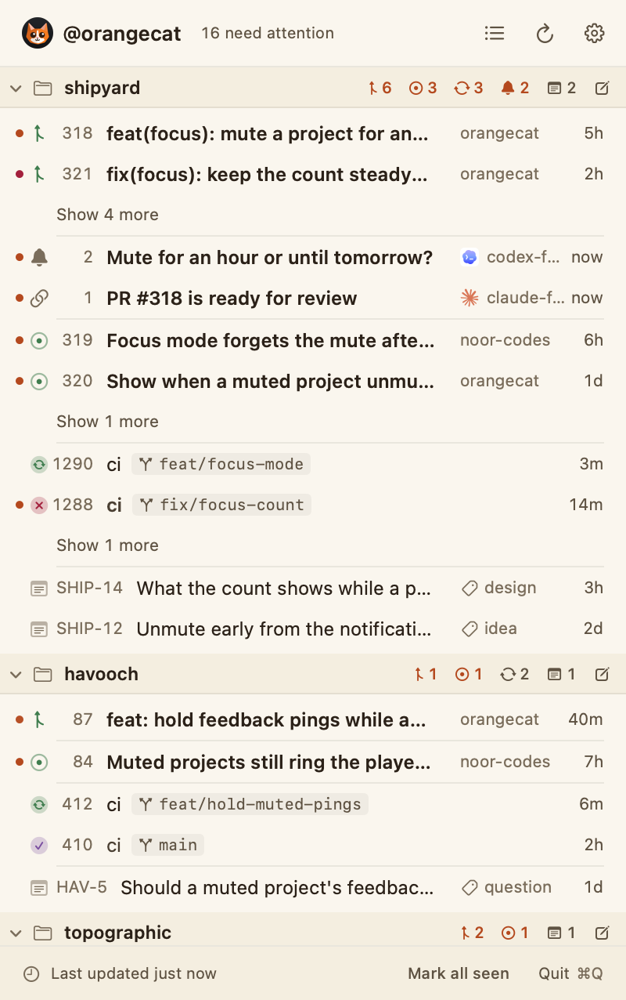
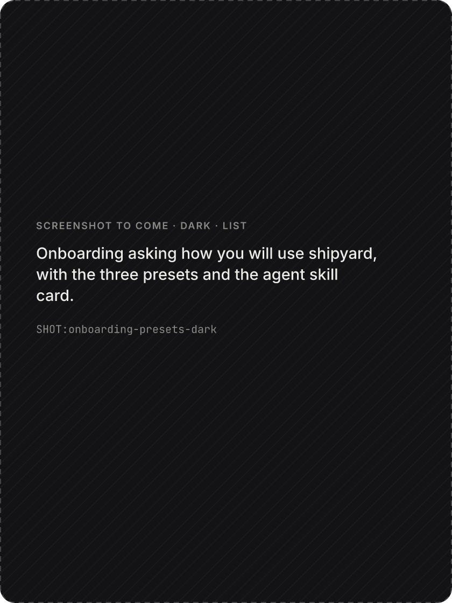
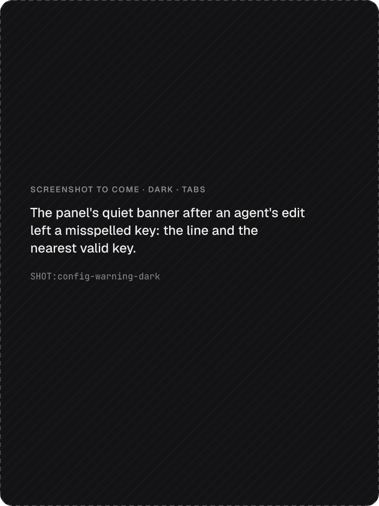
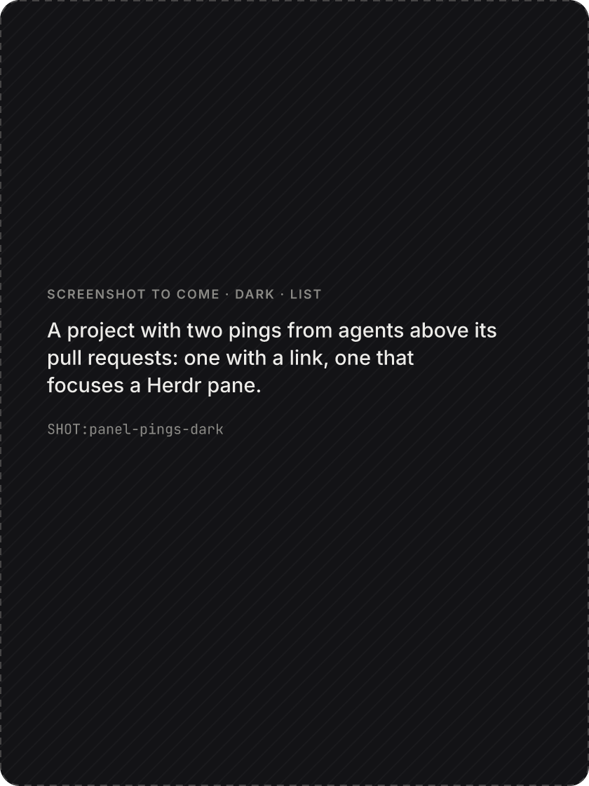
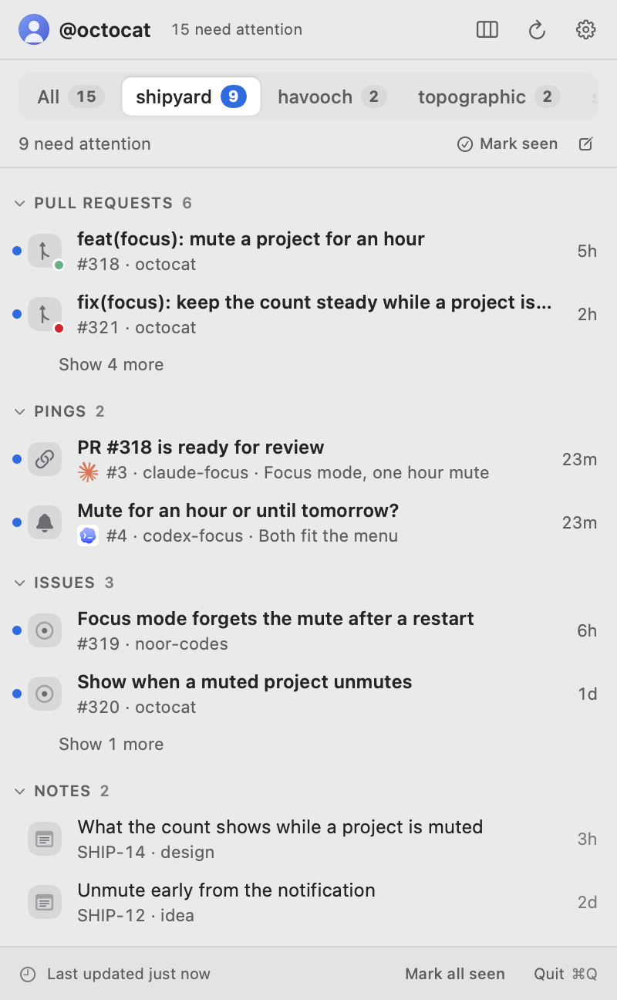

<p align="center"></p>

<h1 align="center">shipyard</h1>

<p align="center">A macOS menu bar app for keeping up with your projects while your agents work.</p>

<p align="center">
  <a href="https://shipyard.yahyapak.dev">Site</a> ·
  <a href="https://shipyard.yahyapak.dev/docs">Docs</a> ·
  <a href="https://github.com/yahyabedirhan/shipyard/releases/latest">Download</a> ·
  <a href="CHANGELOG.md">Changelog</a>
</p>

<p align="center">
  
  
</p>

## Quick start

**1. Install the app.**

```sh
git clone https://github.com/yahyabedirhan/shipyard.git && cd shipyard && make install
```

**2. Teach your coding agent to use it.**

```sh
npx skills add yahyabedirhan/shipyard -g -y
```

**3. Ask in your own words.**

> "Watch this repo in shipyard"

## What it does

Your agents open pull requests and issues and start workflow runs, often several at once across several repositories.
shipyard keeps them in one place.

| | |
|---|---|
| **One menu** | Pull requests, issues and workflow runs, from you, your agents and other people, grouped by project. |
| **One number** | How many items need attention: new, changed since you last opened them, waiting on your review, or failing their checks. |
| **Notifications** | When something happens, by the rules you choose. |
| **Pings** | Your agents tell you when they need you, from this Mac or your other machines. |
| **Notes** | Your own notes, kept in Notion, listed beside each project. |
| **One file** | All settings live in `~/.config/shipyard/config.toml`, edited by you or by your agents. |

## Install

Needs macOS 14 or later and a GitHub account.

### From source

Building also needs the Command Line Tools with Swift 6 (`xcode-select --install`).

```sh
git clone https://github.com/yahyabedirhan/shipyard.git
cd shipyard
make install    # builds, signs and copies Shipyard.app to /Applications, then opens it
```

### From the download

Get `Shipyard-<version>-macos.zip` from the [latest release](https://github.com/yahyabedirhan/shipyard/releases/latest).
It is not notarized, so clear the quarantine flag before the first launch:

```sh
unzip Shipyard-<version>-macos.zip
mv Shipyard.app /Applications/
xattr -dr com.apple.quarantine /Applications/Shipyard.app
open /Applications/Shipyard.app
```

<details>
<summary><b>Updating</b></summary>

Run `git pull && make install` again, or replace the app with a newer zip.

</details>

<details>
<summary><b>Uninstalling</b></summary>

1. If you signed in with GitHub, choose **Sign out** in the gear menu.
2. If you installed the agent skill, remove it with `npx skills remove shipyard -g`.
3. Quit shipyard, then delete the app and its files:

   ```sh
   rm -rf /Applications/Shipyard.app ~/.config/shipyard ~/Library/Application\ Support/Shipyard ~/.local/bin/shipyard
   ```

4. A source build also leaves its module cache and its signing keychain:

   ```sh
   rm -rf ~/Library/Caches/shipyard
   security delete-keychain ~/Library/Keychains/shipyard-signing.keychain-db
   ```

</details>

## First run

shipyard lives in the menu bar, with no Dock icon.

<table>
<tr>
<td width="55%" valign="top">

1. **Connect GitHub.**
   Choose **Sign in with GitHub**, or use the [GitHub CLI](https://cli.github.com) if `gh` is signed in.
2. **Choose a preset,** a ready-made configuration for one use.
3. **Choose what to watch,** when the preset asks.

| Preset | Shows | Asks for |
|---|---|---|
| `my-agents` | The pull requests and issues you and your agents open, one project per repository. | The repositories. |
| `incoming-contributions` | What other people open on your repositories, bots left out, and the pull requests waiting on your review anywhere. | All your repositories, or the ones you pick. |
| `review-queue` | Only the pull requests waiting on your review, in any repository. | Nothing. |

</td>
<td width="45%" valign="top">

</td>
</tr>
</table>

### Controls

| To | Do |
|---|---|
| Open an item on GitHub and mark it seen | Click it. |
| Mark an item seen without opening it | **⌥-click** it. |
| Move through the items and open one | **↑**, **↓** and **Return**. |
| Refresh | **⌘R**. |
| Switch between the `list` and `tabs` layouts | The layout button in the panel's header. |

shipyard starts at login.
Set `launch-at-login = false` to stop that.

## Configure

<table>
<tr>
<td width="55%" valign="top">

Everything lives in `~/.config/shipyard/config.toml`.

- **Open configuration file** in the gear menu opens it.
- Every key is optional.
- Each save applies at once.
- A broken edit keeps the last good configuration and shows the error in the panel.
- `shipyard config check` prints each problem with its line.

The file sets:

- the projects, each a section of the menu with its repositories
- the layout
- what is shown: pull requests, issues, workflow runs, and whose
- how items are grouped and sorted
- which events notify you

</td>
<td width="45%" valign="top">

</td>
</tr>
</table>

| Reference | What it holds |
|---|---|
| [`skills/shipyard/SKILL.md`](skills/shipyard/SKILL.md) | Every key, its default and its allowed values, with worked examples. |
| [`skills/shipyard/presets.md`](skills/shipyard/presets.md) | The three presets in full. |
| [`skills/shipyard/references/themes.md`](skills/shipyard/references/themes.md) | Every theme token and setting. |

### Themes

Pick a theme by name with the top-level `theme` key:

```toml
theme = "Midnight"
```

Six come with the app: **Shipyard** (the default), **Native**, **Graphite**, **Paper**, **Midnight** and **Harbor**.

<details>
<summary><b>A theme of your own</b></summary>

- A theme file is one TOML file in `~/.config/shipyard/themes/`.
- It names its colours by what they mean, such as `surface.panel` or `text.secondary`.
- It can extend a built-in theme and change only a few of them.
- [`docs/themes/example-custom.toml`](docs/themes/example-custom.toml) is a commented theme file to start from.
- A theme file with a problem keeps the theme it last read, and the panel shows the file, the line and the problem.
- `shipyard config check` checks each theme file too.

</details>

### The gear menu

It lists the parts shipyard uses, with a check mark beside each one that is set up:

- **Set up GitHub**
- **Set up Notion**
- **Set up /shipyard skill**
- **Set up shipyard command**

Each opens a view of its status in the panel.

## Use it with your agents

### The agent skill

The skill teaches coding agents that read skills, such as Claude Code and Codex, to edit shipyard's configuration.
Install it during onboarding, from **Set up /shipyard skill** in the gear menu, or from a terminal:

```sh
npx skills add yahyabedirhan/shipyard -g -y
```

Then ask in your own words:

> "Watch this repo in shipyard"
>
> "Hide dependabot's pull requests"
>
> "Tell me when CI fails on this project"
>
> "Switch shipyard to tabs"

The agent edits the file, checks it against the schema, and reads shipyard's verdict on the save.

### Pings

<table>
<tr>
<td width="55%" valign="top">

A ping is a short message from an agent, listed under the project it works in, with a notification.
Clicking it takes you where the agent means:

- it opens a link,
- brings an app forward,
- or focuses the agent's Herdr tab.

A ping:

- needs attention until you click it
- leaves a day after you have seen it (`seen-window`), or when you dismiss it with its ✕
- never reaches GitHub

With the skill installed, ask "ping me when the PR is ready" and the agent knows the rest.

</td>
<td width="45%" valign="top">

</td>
</tr>
</table>

Agents send pings with the `shipyard` command inside the app.
Link it onto your PATH from onboarding or from **Set up shipyard command** in the gear menu, which puts it at `~/.local/bin/shipyard`.

```sh
shipyard ping send "PR #57 is ready for review" --from claude --open https://github.com/my-org/shop/pull/57
shipyard ping send "Waiting for your input" --herdr --id shop-question   # brings you back to this Herdr pane
shipyard ping withdraw shop-question                                     # takes it back once you've answered
```

<details>
<summary><b>More about pings</b></summary>

- A ping is filed under the projects that watch the repository of the agent's working folder.
- `shipyard ping --help` lists every flag.
- If your `config.toml` lists its own notification rules, add `{ event = "ping.sent" }` to hear about pings.
- For a status message that needs nothing from you, such as "tests running", agents use `shipyard notice send`. It is a notification when a rule selects `agent.notice`, and is never kept in the panel.

</details>

### Pings from your other machines

Agents on your other machines can ping you too, when your Mac's Herdr knows those machines as saved machines.

1. Install the [herdr-shipyard](https://github.com/yahyabedirhan/herdr-shipyard) plugin on each machine. It puts the same `shipyard` command there.

   ```sh
   herdr plugin install yahyabedirhan/herdr-shipyard
   ```

2. Name the machines in `config.toml` by their Herdr labels:

   ```toml
   [remote]
   machines = ["alpha-vps"]
   ```

<details>
<summary><b>How it works</b></summary>

- shipyard asks each machine for its pings through Herdr about every 30 seconds.
- It files them under the projects that watch their repositories, or under the machine's name.
- Clicking one sent from a Herdr pane takes you to that agent.
- The plugin also pings you by itself when Herdr marks an agent blocked, and takes the ping back when the agent goes on.
- A machine that does not answer shows a quiet line and keeps its last pings.

</details>

### Notes

<table>
<tr>
<td width="55%" valign="top">

Your own notes, kept in Notion, list under each project too.

- Dictate a note to any agent and it writes it there.
- Each project lists its open notes, newest first, with their numbers (`SHOP-7`) and labels.
- Clicking one opens it in Notion.
- The pencil icon on a project's header starts a note there.

Notes are opt-in.
shipyard keeps no Notion token of its own: it reads and writes through [`ntn`](https://developers.notion.com/cli/get-started/overview), Notion's CLI, with ntn's own login.

</td>
<td width="45%" valign="top">

</td>
</tr>
</table>

To connect:

1. Install ntn:

   ```sh
   curl -fsSL https://ntn.dev | bash
   ```

2. Run `ntn login` in Terminal and choose your notes workspace.
3. Check with `ntn doctor` that it is ntn's default workspace.
4. Open **Set up Notion** in the gear menu and choose **Connect with ntn**.

<details>
<summary><b>How it works</b></summary>

- Each project has one database, titled with the project's title, under a "Projects" page inside a "Shipyard Notes" page.
- The notes are read every minute and whenever you open the menu.
- While ntn is missing or logged out, or its workspace has no Shipyard Notes page, a banner says what to do.
- `shipyard notes check` reports what is wrong.
- **Disconnect** in the same view stops it.
- `notes = { show = false }` in a project's block keeps that project's notes out.

</details>

## Examples

Each configuration made the screenshot beside it, trimmed to the lines that matter.
The first three watch two repositories as one project, with issues turned on.

<table>
<tr>
<th width="50%">Configuration</th>
<th width="50%">Result</th>
</tr>
<tr>
<td colspan="2"><b>The list layout,</b> grouped by repository under subheaders, four rows a group.</td>
</tr>
<tr>
<td valign="top">

```toml
version = 1
[menu]
layout = "list"
[defaults]
group-by = "repository"
subsections = true
show-first = 4
[defaults.issues]
show = true
[[projects]]
slug = "shipyard"
repositories = ["yahyabedirhan/shipyard", "yahyabedirhan/skills"]
```

</td>
<td valign="top">

</td>
</tr>
<tr>
<td colspan="2"><b>The same file in the tabs layout.</b> The All tab always groups by kind; each project's tab follows its configuration.</td>
</tr>
<tr>
<td valign="top">

```toml
version = 1
[menu]
layout = "tabs"
[defaults]
group-by = "repository"
subsections = true
show-first = 4
[defaults.issues]
show = true
[[projects]]
slug = "shipyard"
repositories = ["yahyabedirhan/shipyard", "yahyabedirhan/skills"]
```

</td>
<td valign="top">

</td>
</tr>
<tr>
<td colspan="2"><b>Grouped by date,</b> three rows a group.</td>
</tr>
<tr>
<td valign="top">

```toml
version = 1
[menu]
layout = "list"
[defaults]
group-by = "date"
subsections = true
show-first = 3
[defaults.issues]
show = true
[[projects]]
slug = "shipyard"
repositories = ["yahyabedirhan/shipyard", "yahyabedirhan/skills"]
```

</td>
<td valign="top">

</td>
</tr>
<tr>
<td colspan="2"><b>No projects, or no file at all.</b> The panel asks how you will use shipyard, offers the three presets, and offers the agent skill.</td>
</tr>
<tr>
<td valign="top">

```toml
version = 1
```

</td>
<td valign="top">

</td>
</tr>
</table>

## Limits

- shipyard runs on macOS 14 or later. The `shipyard` command also runs on Linux, without the app.
- It reads github.com only, not GitHub Enterprise Server.
- The download is not notarized, and there is no Homebrew cask or automatic update.
- Most settings live in `config.toml`, edited by you or your agents. The app writes the file only for the preset and repositories chosen during onboarding, and for the layout button in the panel's header.
- With Herdr 0.9.3, clicking another machine's ping focuses its pane on that machine, but your Mac's Herdr window moves there only when it already shows that machine. Otherwise nothing visible happens and the ping is marked seen; switch Herdr to that machine yourself. Herdr has no command yet that switches an open window to a saved machine.

## Development

```sh
make test       # runs the tests
make release    # builds the release zip
```

| Doc | What it holds |
|---|---|
| [`CONTRIBUTING.md`](CONTRIBUTING.md) | How to report a problem and open a pull request. |
| [`SECURITY.md`](SECURITY.md) | How to report a vulnerability. |
| [`AGENTS.md`](AGENTS.md) | How releases are cut, in its Releases section. |
| [`CHANGELOG.md`](CHANGELOG.md) | An entry for each release. |
| [`docs/low-level-design.md`](docs/low-level-design.md) | The design. |
| [`GLOSSARY.md`](GLOSSARY.md) | The glossary. |
| [`docs/messaging.md`](docs/messaging.md) | The words every public surface uses. |

<details>
<summary><b>Build notes</b></summary>

- With the Command Line Tools alone, the first build compiles the SDK's Swift modules (about 40 s).
- The `Makefile` keeps them in `~/Library/Caches/shipyard/ModuleCache`, so every other checkout and worktree reuses them.
- Installing Xcode avoids the cost, since it ships them prebuilt.
- Publishing a GitHub release runs the [`linux cli`](.github/workflows/linux-cli.yml) workflow. It attaches static Linux builds of the `shipyard` command (`shipyard-linux-x86_64`, `shipyard-linux-aarch64` and their `.sha256` files) to the release.

</details>

### Forks

Sign in with GitHub uses the OAuth App client ID compiled into the build.
A fork should use its own:

1. Create an OAuth App on GitHub (**Settings > Developer settings > OAuth Apps**).
2. Tick **Enable Device Flow**.
3. Put its client ID in `OAuthApp.clientID` in `Sources/ShipyardCore/GitHub/Auth/DeviceFlow.swift`.

Without one, the build connects through `gh` only.
See [`docs/references/github-device-flow.md`](docs/references/github-device-flow.md) for GitHub's limits.

## License

The code is licensed under the [Apache License 2.0](LICENSE).
See [LICENSE](LICENSE) and [NOTICE](NOTICE).
If you use or adapt it, please credit Yahya Bedirhan Pak with a link to [yahyapak.dev](https://yahyapak.dev).

The project name, the logo and app icon in `assets/images/` and the screenshots in `assets/screenshots/` are not covered by this license and are all rights reserved.
The bundled agent and service logos are their owners'; see [`THIRD-PARTY-NOTICES.md`](THIRD-PARTY-NOTICES.md).
